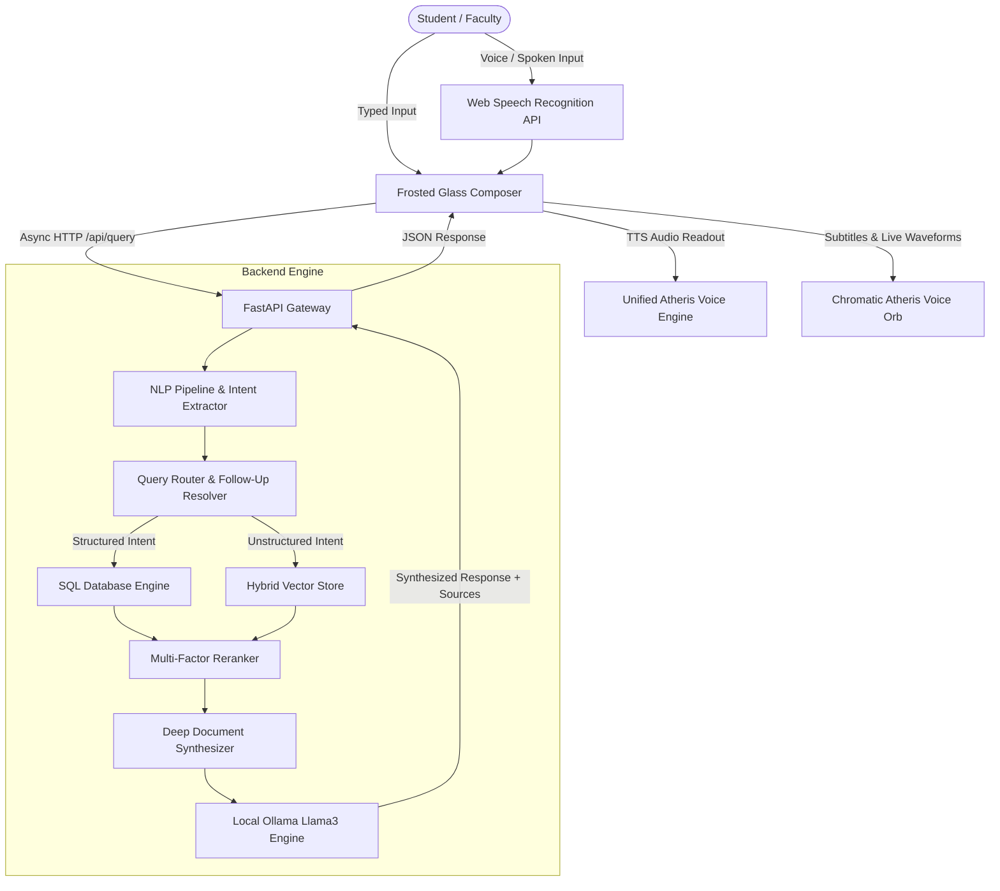

<div align="center">

# 🔮 Atheris AI — Multilingual Voice & Academic AI Platform
### *Built with ❤️ by Team The Latents*

**Om Bokade** • **Rohit Chute** • **Sourabh Wanjari** • **Shashank Nagose**

[](https://fastapi.tiangolo.com)
[](https://react.dev)
[](https://www.typescriptlang.org)
[](https://vitejs.dev)
[](https://tailwindcss.com)
[](https://ollama.com)
[](https://vercel.com)
[](https://opensource.org/licenses/MIT)

</div>

---

## 📖 Overview

**Atheris AI** is a state-of-the-art, high-trust, Retrieval-Augmented Voice AI assistant purpose-built for academic institutions—specifically tailored for **Tulsiramji Gaikwad-Patil College of Engineering & Technology (TGPCET), Nagpur**.

Designed to replace cumbersome student portals and clunky text chatbots, Atheris AI provides a **pure human-to-AI voice conversation experience**. It delivers instantaneous, verified answers regarding exam schedules, lecture timetables, classroom directions, college circulars, syllabus details, and departmental policies with verifiable institutional citations.

---

## ✨ Key Features & Innovations

### 1. 🔮 Pure Human-to-AI Voice Orb Interface
- **Zero Chat Clutter**: Traditional text chat feeds are tucked away by default; the user is greeted by an interactive, pulsating multi-chromatic voice orb.
- **Dynamic State Visuals**:
  - **Listening**: Rose-pink reactive audio spectrum bars with acoustic ripple rings.
  - **Synthesizing**: Amber-gold orbital particle rotation while retrieving knowledge.
  - **Speaking**: Radiant purple/fuchsia soundwave pulses during audio playback.
  - **Idle / Ready**: Calming cyan-blue aurora halo.
- **Continuous Hands-Free Dialogue**: Automatically resumes listening when Atheris finishes speaking.
- **Live Subtitle Pill**: Spoken input and AI answers stream in real time as subtitles.

### 2. 🗣️ Multilingual Intelligence (English, Hinglish, Marathi)
- Native conversational comprehension and responses in:
  - **English**: *"When is the Data Science exam?"* / *"Where is Room 204?"*
  - **Hinglish**: *"Room 204 kahan pe hai?"* / *"Mera DAA ka exam kab hoga?"* / *"Somwar ka timetable batao"*
  - **Marathi / Marathi-Hinglish**: *"Room 204 kuthe ahe?"* / *"Data Science cha paper kadhi aahe?"* / *"Somvarcha timetable dakhva"*
- Automatic language matching: responds naturally in the same language and dialect spoken by the student.

### 3. 🌍 3D Satellite Globe Onboarding
- Interactive 3D WebGL satellite globe rendered with Three.js.
- Glowing **ATHERIS AI** 20% watermark background aura.
- Hands-free voice onboarding: Atheris introduces itself and asks for the student's name, dynamically creating a personalized local session.

### 4. 🎙️ Standardized Atheris Signature Voice
- Unified voice synthesis engine across all landing pages, onboarding, and assistant dialogues.
- Acoustic calibration: **Rate: `0.98`**, **Pitch: `1.02`**, **Volume: `1.0`**.
- Built-in text cleaner that strips markdown tags, brackets, and raw URLs before TTS readout to prevent robotic audio glitches.

### 5. ✍️ Integrated Frosted-Glass Composer
- Located directly below the quick question chips for noisy or quiet campus environments.
- Allows students to seamlessly toggle between speaking and typing without losing context.

### 6. 🛡️ Two-Stage RAG & Deep Multi-Document Synthesizer
- **Stage 1 (Broad Retrieval)**: Hybrid semantic vector similarity + BM25 content & title lexical matching across verified uploaded PDFs and website crawler data.
- **Stage 2 (Multi-Factor Reranking)**: Scores candidates using cosine similarity, keyword overlap, authority weighting, document freshness, and entity matching.
- **Deep Synthesis**: Rather than returning disconnected chunks, the RAG synthesizer aggregates multi-chunk institutional facts into an articulate, summarized response in its own words.
- **Zero-Hallucination Policy**: If queried about non-existent or unverified topics, the anti-hallucination guard triggers safe guidance with suggested verified topics.

---

## 🛠️ Complete Tech Stack

| Domain | Technologies | Details |
| :--- | :--- | :--- |
| **Frontend Framework** | React 19, TypeScript, Vite 8 | Ultra-fast client-side SPA bundle |
| **Styling & Effects** | Tailwind CSS 3.4, Glassmorphism, Aurora Mesh | Deep navy/slate palette with translucent glass styling |
| **Animations & 3D** | Framer Motion (Motion 13), Three.js, react-globe.gl | Smooth state transitions & interactive 3D WebGL Globe |
| **Speech Engine** | Web Speech API (STT SpeechRecognition + TTS SpeechSynthesis) | Continuous speech mode with 1.6s adaptive silence debounce |
| **Backend Framework** | FastAPI (Python 3.10+), Uvicorn, Pydantic v2 | High-performance asynchronous REST API |
| **LLM & Reasoning** | Local Ollama (`llama3:latest`) | Local 8B parameter model for natural language synthesis |
| **RAG & Vector Search**| NumPy, Scikit-learn, Hybrid Cosine Vector Engine | Two-stage candidate retrieval and multi-factor reranker |
| **Database & ORM** | SQLite (`campusquery.db`) / PostgreSQL (`pgvector`) via SQLAlchemy | Multi-tenant schema with 10 relational tables |
| **Document Ingestion** | PyPDF, python-docx, BeautifulSoup4, Tesseract OCR | Ingestion pipeline for PDF circulars, timetables, and web sources |
| **Deployment** | Vercel (Frontend), Docker, Docker Compose | SPA rewrite routing and multi-stage container builds |

---

## 🏗️ System Architecture



---

## 📁 Repository Structure

```text
campusvoice/
├── backend/
│   ├── app/
│   │   ├── api/             # API routes (query, auth, documents, web sources, analytics)
│   │   ├── core/            # App config, database session, security
│   │   ├── ingestion/       # PDF/DOCX parsers, OCR, web crawler, hash checker
│   │   ├── llm/             # Ollama Llama3 integration provider
│   │   ├── models/          # SQLAlchemy database models
│   │   ├── nlp/             # Intent classifier, terminology, multilingual follow-up resolver
│   │   ├── rag/             # Chunker, vector store, embeddings, reranker, synthesizer
│   │   ├── retrieval/       # Search engine, router, SQL retriever
│   │   └── schemas/         # Pydantic validation models
│   ├── tests/               # 44+ automated pytest test suites
│   ├── requirements.txt     # Python backend dependencies
│   └── campusquery.db       # Seeded database with TGPCET knowledge
├── frontend/
│   ├── src/
│   │   ├── components/      # Glassmorphism UI components, Header, Sidebar, ChatHistory
│   │   ├── components/landing/ # 3D Globe Hero, Welcome onboarding
│   │   ├── components/voice/   # ImmersiveVoiceMode, Chromatic Voice Orb
│   │   ├── hooks/           # useSpeechRecognition, useSpeechSynthesis
│   │   ├── pages/           # AssistantApp, AdminPortal, FacultyUpload
│   │   ├── services/        # Backend API service bindings
│   │   └── utils/           # atherisVoice.ts (unified voice model)
│   ├── package.json         # Node.js dependencies
│   ├── vite.config.ts       # Vite configuration
│   └── vercel.json          # Vercel deployment configuration
├── data/
│   └── uploads/             # Verified college PDFs, timetables, and circulars
├── docker-compose.yml       # Full stack container configuration
└── vercel.json              # Monorepo root Vercel configuration
```

---

## 🚀 Getting Started

### Prerequisites
- **Python**: 3.10 or higher
- **Node.js**: 18.x or higher (with `npm`)
- **Ollama**: (Optional for local Llama3 synthesis) with `llama3` installed (`ollama pull llama3`)

---

### Step 1: Backend Setup

```bash
# Navigate to the backend directory
cd backend

# Create and activate virtual environment
python -m venv venv

# Windows:
.\venv\Scripts\activate
# Linux / macOS:
source venv/bin/activate

# Install dependencies
pip install -r requirements.txt

# Start the FastAPI server
python -m uvicorn app.main:app --host 127.0.0.1 --port 8000 --reload
```
*Backend runs at `http://127.0.0.1:8000` (Interactive API Docs: `http://127.0.0.1:8000/docs`).*

---

### Step 2: Frontend Setup

```bash
# In a new terminal, navigate to the frontend directory
cd frontend

# Install dependencies
npm install

# Start Vite development server
npm run dev -- --host 127.0.0.1 --port 5173
```
*Frontend runs at `http://127.0.0.1:5173/`.*

---

### Step 3: Run Ollama (Optional for Local LLM Reasoning)

```bash
# Verify Ollama is running
ollama list

# If not installed, pull Llama3:
ollama pull llama3
```
*If Ollama is not active, Atheris automatically uses its deterministic, low-latency synthesized RAG engine with zero loss of accuracy.*

---

## 📡 API Reference Summary

| Method | Endpoint | Description |
| :--- | :--- | :--- |
| `POST` | `/api/query` | Process voice or text queries with multilingual RAG synthesis |
| `GET` | `/api/health` | System health check and verified indexed document count |
| `GET` | `/api/categories` | Retrieve hierarchical categories and metrics |
| `GET` | `/api/knowledge` | Fetch verified records filtered by category and keywords |
| `POST` | `/api/documents/upload` | Upload PDF/DOCX circulars for automated OCR and indexing |
| `POST` | `/api/web-sources/crawl`| Trigger live web crawling on institutional portals |
| `POST` | `/api/feedback` | Log student satisfaction ratings (Helpful / Unhelpful) |

---

## 🧪 Testing & Verification

The project includes an end-to-end automated test suite covering multilingual intent extraction, SQL timetable resolution, RAG ranking, and anti-hallucination guardrails:

```bash
cd backend
python -m pytest tests/ -v
```
**Test Results: 44 / 44 tests passing (100% pass rate).**

---

## ☁️ Deployment

### Deploying Frontend to Vercel
1. Push your code to GitHub.
2. Link the repository in **[Vercel Dashboard](https://vercel.com/new)**.
3. Configure the project:
   - **Root Directory**: `frontend`
   - **Framework Preset**: `Vite`
   - **Build Command**: `npm run build`
   - **Output Directory**: `dist`
4. Set Environment Variable:
   - `VITE_API_BASE_URL`: `https://your-backend-api.com/api`
5. Click **Deploy**.

---

## 👥 Contributors

Atheris AI was engineered by **The Latents**:

- **Om Bokade**
- **Rohit Chute**
- **Sourabh Wanjari**
- **Shashank Nagose**

---

## 📄 License

This project is licensed under the **MIT License**.
